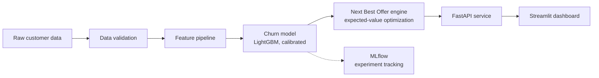

# Telecom Customer Churn Prediction & Retention Optimization

An end-to-end decision system that predicts which telecom customers are likely to churn, recommends the most cost-effective retention offer for each, and quantifies the revenue it protects.

> **Status:** 🚧 In progress. Exploratory analysis complete; modeling underway. See [Roadmap](#roadmap).

---

## Executive Summary

Most churn projects stop at *"who will leave?"*. A retention team needs more than that. With a limited budget, they need to know:

1. **Who** is at risk of churning?
2. **Who is worth saving**, given their value and the cost of an offer?
3. **What offer** gives the best return for each customer?
4. **How much revenue** does the program protect?

This project is designed to answer all four, combining a churn model with a business decision layer.

---

## Business Framing

Ranking customers by churn probability alone wastes budget: a high-risk, low-value customer may not be worth an offer. This system prioritizes by **expected value**:

```
Expected value of an offer = P(churn) × customer value × P(offer works) − offer cost
```

Customers are targeted only when the expected value is positive, and contacted in order of value until the retention budget runs out.

---

## Key Findings (Exploratory Analysis)

| Finding | Result | Implication |
|---|---|---|
| Overall churn rate (baseline) | **27%** | Reference point for all segments |
| Month-to-month contracts | **43%** churn vs **3%** for two-year | Contract migration offers are a key lever |
| First 6 months of tenure | **53%** churn (about 2× baseline) | Onboarding is the highest-risk window |
| Customers past 4 years | **10%** churn | Low priority for retention spend |

Full analysis: [`notebooks/01_explore_data.ipynb`](notebooks/01_explore_data.ipynb)

---

## Solution Architecture



| Component | Purpose |
|---|---|
| **Data validation** | Catch bad or unexpected input before it reaches the model |
| **Feature pipeline** | Identical preprocessing in training and production (no train/serve skew) |
| **Churn model** | Predicts the probability that each customer churns |
| **Probability calibration** | Makes predicted probabilities trustworthy for revenue calculations |
| **Next Best Offer engine** | Chooses the offer with the highest expected value under a budget |
| **API** | Serves predictions and recommendations to other systems |
| **Dashboard** | An executive view (revenue impact) and an agent view (who to call, what to offer) |

---

## Evaluation Plan

Only about 27% of customers churn, so accuracy is misleading: a model that predicts "no churn" for everyone would be 73% accurate and useless. The model will be judged on:

| Metric | Why it matters |
|---|---|
| **PR-AUC** | Measures how well churners are found in imbalanced data |
| **Lift in the top 10%** | How much better than random targeting the highest-risk group is, which matches how a retention team actually works |
| **Calibration** | Whether a predicted "70% risk" really means about 70%, which the revenue math depends on |
| **Baseline comparison** | Every model must beat a simple logistic regression to justify its complexity |

---

## Assumptions & Limitations

- **Postpaid data:** this dataset describes postpaid subscribers. Markets like Jordan are heavily prepaid, where churn is not a cancellation but a customer who stops recharging. Deploying this in such a market would require redefining churn (e.g. no activity for 30+ days). This is addressed in the planned prepaid extension (see Roadmap).
- **No offer-response data:** the dataset doesn't record which offers customers received or how they responded. Offer acceptance rates will be **simulated assumptions**, clearly labeled, and should be replaced by A/B test results in production.
- **Single snapshot:** the data is one point in time, so the model cannot learn from changes in customer behavior over time.

---

## Dataset

[IBM Telco Customer Churn](https://www.kaggle.com/datasets/blastchar/telco-customer-churn): 7,043 customers, 21 columns covering demographics, services, contract, billing and churn status.

Data is **not committed** to this repository, following standard practice for customer data. Download the CSV and place it at:

```
data/WA_Fn-UseC_-Telco-Customer-Churn.csv
```

---

## Project Structure

```
telecom-churn-prediction/
├── data/                  # Raw data (not committed)
├── notebooks/
│   └── 01_explore_data.ipynb
├── requirements.txt
└── README.md
```

---

## Setup

```bash
git clone https://github.com/mohammadhamayel23/telecom-churn-prediction.git
cd telecom-churn-prediction
python -m venv .venv
.venv\Scripts\activate          # Windows
# source .venv/bin/activate     # Mac/Linux
pip install -r requirements.txt
```

---

## Roadmap

- [x] Project setup and version control
- [x] Exploratory data analysis
- [x] Data quality fixes (`TotalCharges`)
- [x] Data preparation and feature pipeline
- [ ] Baseline model (logistic regression)
- [ ] Advanced model (LightGBM) with tuning and calibration
- [ ] Model explainability (SHAP)
- [ ] Next Best Offer engine
- [ ] Business value simulation
- [ ] API (FastAPI) and dashboard (Streamlit)
- [ ] Containerization (Docker) and CI
- [ ] Prepaid market extension: synthetic prepaid dataset (churn = no recharge for 30+ days) to adapt the pipeline to markets like Jordan

---

## Tech Stack

**Current:** Python · pandas · matplotlib · Jupyter
**Planned:** scikit-learn · LightGBM · SHAP · MLflow · FastAPI · Streamlit · Docker